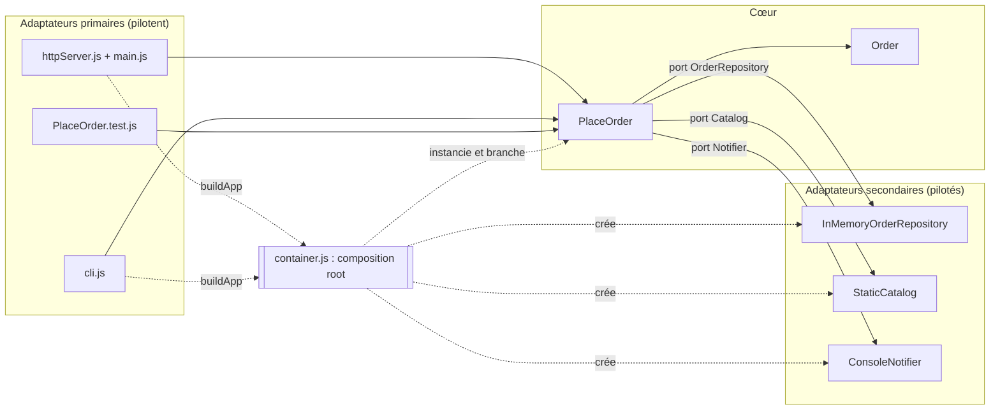

# ETAPE 1

Format de lecture: Porte -> résultat obtenu
    - Ligne de commande -> [e-mail simulé] Commande CMD-0001 confirmée pour C-42 : 117 €
    Commande créée : {"id":"CMD-0001","customerId":"C-42","lines":[{"sku":"CLAVIER","qty":2,"unitPrice":49},{"sku":"SOURIS","qty":1,"unitPrice":19}],"total":117,"createdAt":"2026-10-21T13:27:01.466Z"}

    - HTTP : commande valide -> HTTP/1.1 201 Created
                                Content-Type: application/json; charset=utf-8
                                Date: Wed, 21 Oct 2026 14:12:38 GMT
                                Connection: close
                                Transfer-Encoding: chunked

                                {
                                "id": "CMD-0005",
                                "customerId": "C-42",
                                "lines": [
                                    {
                                    "sku": "CLAVIER",
                                    "qty": 2,
                                    "unitPrice": 49
                                    },
                                    {
                                    "sku": "SOURIS",
                                    "qty": 1,
                                    "unitPrice": 19
                                    }
                                ],
                                "total": 117,
                                "createdAt": "2026-10-21T14:12:38.800Z"
                                }

    - HTTP : relecture de la commande -> HTTP/1.1 200 OK
                                        Content-Type: application/json; charset=utf-8
                                        Date: Wed, 21 Oct 2026 14:15:58 GMT
                                        Connection: close
                                        Transfer-Encoding: chunked

                                        {
                                        "id": "CMD-0001",
                                        "customerId": "C-42",
                                        "lines": [
                                            {
                                            "sku": "CLAVIER",
                                            "qty": 2,
                                            "unitPrice": 49
                                            },
                                            {
                                            "sku": "SOURIS",
                                            "qty": 1,
                                            "unitPrice": 19
                                            }
                                        ],
                                        "total": 117,
                                        "createdAt": "2026-10-21T13:31:53.648Z"
                                        }

    - HTTP : produit inconnu -> HTTP/1.1 400 Bad Request
                                Content-Type: application/json; charset=utf-8
                                Date: Wed, 21 Oct 2026 14:21:26 GMT
                                Connection: close
                                Transfer-Encoding: chunked

                                {
                                "error": "Produit inconnu : TELE"
                                }

    - HTTP : commande vide -> HTTP/1.1 400 Bad Request
                            Content-Type: application/json; charset=utf-8
                            Date: Wed, 21 Oct 2026 14:22:10 GMT
                            Connection: close
                            Transfer-Encoding: chunked

                            {
                            "error": "Une commande doit contenir au moins une ligne"
                            }

    - Tests -> 3 tests (tous réussis), non aucun serveur nécessaire

    - Ce qui est identique : dans les trois cas c'est le même cas d'utilisation PlaceOrder.handle() qui est appelé, avec le même domaine Order et les mêmes règles.

    - Ce qui change : seulement l'adaptateur primaire, qui traduit l'entrée (arguments de la ligne de commande, requête HTTP en JSON, appel direct dans le test) et la sortie (console, code HTTP, assertions).
    Dans les tests, les adaptateurs secondaires sont aussi remplacés par des faux.

# ÉTAPE 2

- container.js -> en dehors de l'hexagone, du côté des entrées. C'est la composition root: le seul fichier qui connaît toutes les classes concrètes, il les crée et les branche sur les ports de PlaceOrder (utilisé par main.js et cli.js).

- Règle de dépendance -> les dépendances pointent toujours vers le centre : domain/ n'importe rien, application/ importe seulement domain/, et seuls les adaptateurs et container.js connaissent la technique (vérifié par npm run lint:archi).
